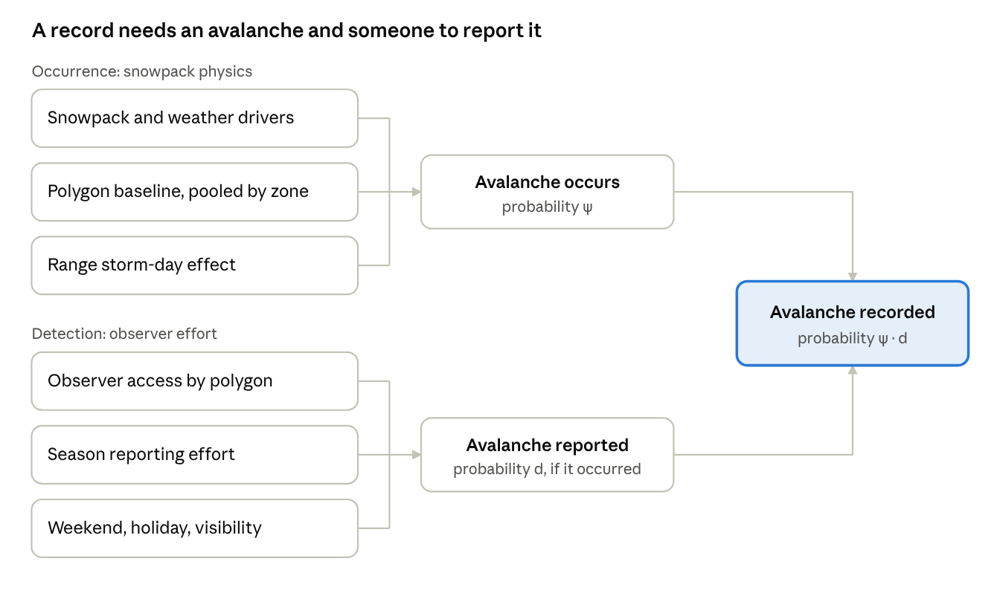

# Avalanche Likelihood Model — Methods

Oct 28, 2026 · Ron Simenhois

## Objective

We estimate, for each of the 147 backcountry forecast polygons and each day, the probability that at least one D2 or larger dry slab avalanche occurs. The model treats avalanche reports as incomplete: a report confirms an avalanche, but no report does not rule one out.

**Scope: dry slab avalanches only.** Wet slab and wet loose avalanches have different drivers (melt, rain, the loss of strength as liquid water enters the snowpack) and a different daily timing. They are outside the scope of this model and need a separate one. Loose dry avalanches, cornice falls and glide avalanches are also excluded.

This replaces the event model in the current pipeline, a positive-unlabeled RandomForest. Its reported test AUC of 0.90 came from a random split of polygon-days. Holding out a whole season, its AUC fell to 0.48 and 0.55, below a day-of-season plus polygon baseline (0.68 and 0.58). It was also trained on only 7 polygons and applied to all 147.

Danger-rating prediction is out of scope until the likelihood model shows skill on held-out seasons.

## Data

Three seasons have both avalanche observations and SNOWPACK output: 2023-24, 2024-25 and 2025-26. A season runs October to September and is labeled by its starting year (2025 = October 2025 to September 2026).

| Source | Location | Coverage |
| --- | --- | --- |
| Avalanche observations | `data/raw/caic-avalanche-records-2026-10-28.csv` (CAIC export) | 11,199 rows, 2023-10-15 to 2026-10-27 |
| Forecast polygons | `data/raw/BC_Polygons.geojson` | 147 polygons |
| Snowpack and weather drivers | `/ssd/snowpack/fcst/<season>/zone<NNN>/<station>/<station>_res.smet` | One SNOWPACK station per polygon, nearest to its centroid; 107,900 polygon-days over three seasons |

Zone folders changed in 2025 (90 zones before, 134 after), so the same station sits in a different zone folder by season; stations are looked up by ID.

Each row of the export is one avalanche, or a group of similar avalanches whose count is in the `#` column. Rows that share an observation ID come from the same report, so they are kept as separate records.

### Assigning avalanches to polygons

Each record is assigned to the polygon that contains its latitude and longitude (`src/avalanche_observations.py`).

1. Drop exact duplicate rows: 118 of 11,199.
2. Take the occurrence date from `Date`, converted to Mountain time. `Date Known` says whether that date is known (30% of records) or estimated (70%).
3. Test each point against the polygon shapes and keep the polygon that contains it.
4. Drop records outside every polygon: 99 of 11,081. Of these, 88 are outside Colorado and 11 lie 1 to 5 km outside a polygon edge.

The result is 10,982 records in 108 of the 147 polygons, summarized as 4,438 polygon-days with at least one recorded avalanche.

| Season | Records | Avalanches | Polygon-days with activity |
| --- | --- | --- | --- |
| 2023-24 | 4,030 | 6,029 | 1,728 |
| 2024-25 | 4,166 | 5,850 | 1,611 |
| 2025-26 | 2,756 | 4,029 | 1,085 |
| 2026-27 (to Oct 27) | 30 | 72 | 14 |

Records are very uneven across polygons. The median polygon has 32 avalanches over three seasons, the busiest has 2,007, and 39 have none. That spread reflects where observers travel as much as where avalanches happen.

## Labels and the positive-unlabeled problem

The unit of analysis is a polygon-day: 147 polygons over November to May of each season. A polygon-day is labeled 1 when at least one D2 or larger dry slab avalanche (type `SS` soft slab or `HS` hard slab) is recorded in the polygon on that day, and 0 otherwise.

| Season | D2+ dry slab polygon-days | D2+ polygon-days (any type) | Natural-trigger polygon-days | Any-avalanche polygon-days |
| --- | --- | --- | --- | --- |
| 2023-24 | 688 | 814 | 1,083 | 1,728 |
| 2024-25 | 525 | 714 | 1,029 | 1,611 |
| 2025-26 | 292 | 404 | 709 | 1,085 |

Of the 1,915 D2+ polygon-days, 1,505 include a dry slab. Wet avalanches account for most of the rest in spring: in May, 65 D2+ wet avalanche records against 17 dry slab ones. 196 polygon-days have only records with no type (`-` or `U`). They are left out because they can't be confirmed as dry slabs. Most fall in December to February, so most are probably dry slabs, and the label slightly undercounts.

A 0 means no avalanche was reported, not that none occurred. An avalanche enters the record only if it happens and someone sees and reports it. Reporting depends on where observers travel, the weather, weekends, and how much effort the forecast center puts into field work in a given season. The model therefore separates two probabilities: that an avalanche occurred, and that it was reported given that it occurred (see Model).

Label choices that differ from the previous pipeline:

- **Occurrence date, not report date.** The previous pipeline used the report timestamp. The export's `Date` is the estimated or known occurrence date.
- **No forward smearing.** The previous label marked a day positive if an event fell anywhere from the day before to two days after. That leaks future observations into today's label and multiplied positives about 2.4 times.
- **Date uncertainty is kept explicit.** 70% of dates are estimated. A sensitivity run will let an estimated-date avalanche count on its date or the day before.
- **D2+ dry slabs as the main label.** D2+ avalanches can bury, injure or kill a person, and their larger debris is easier to see from a distance than D1. Restricting to dry slabs matches the label to the drivers. The D2+ (any type), natural-trigger and any-size labels are kept as alternatives (`--label`).

### Why not the spy method

The previous pipeline used the spy method for positive-unlabeled learning. Some known positives ("spies") are hidden among the unlabeled days, a classifier is trained on positive against unlabeled, and unlabeled days scoring below most spies are taken as reliable negatives. This works only if recorded avalanches are a random sample of all avalanches, with one reporting rate c everywhere and on every day ("selected completely at random"). That assumption fails here:

1. **The reporting rate varies by orders of magnitude.** It depends on the polygon (highways, ski areas, trailheads), weekends, the season's field effort and visibility after storms. The spies come from the reported avalanches, mostly in data-rich polygons, so the threshold encodes those polygons' reporting rate.
2. **The reliable negatives in low-data polygons aren't negatives.** There, an unlabeled day with avalanche-prone conditions is often an unreported avalanche. Corrections that divide by c (Elkan and Noto) are off by the ratio of the two reporting rates, easily 10×.
3. **The classifier learns where people report, not when avalanches happen.** Climatology alone reaches a pooled AUC of 0.90. The previous model's 0.90 on a random split fell to 0.48 and 0.55 on held-out seasons, below that baseline. A random split also leaks within storm cycles, since neighboring days are near-copies.
4. **It extrapolates without any adjustment.** It was trained on 7 polygons and applied to 147. Access is entangled with terrain and snow climate, so the model can't tell a different snowpack from different observers, and it can't express that it doesn't know.

The occupancy-detection model is still positive-unlabeled learning, but it models the reporting rate instead of assuming it is constant ("selected at random" with a reporting submodel). Occurrence shares the driver effects across all polygons, so the data-rich polygons teach the physics. Reporting is estimated per polygon, pooled within its region, with season and weekend effects, so data-rich polygons don't impose their reporting rate on the others. Low-data polygons borrow driver effects from all polygons and their reporting level from their region, and their uncertainty shows: the 90%/10% quantile ratio of the record probability is 74 in polygons with no training events, against 3.2 in polygons with over 10.

Neither approach escapes one limit. Without an outside anchor, the records can't tell many poorly reported avalanches from few well reported ones. The spy method hides this behind its constant c. This model makes the assumption explicit: given the same snowpack, every polygon has the same avalanche frequency, so differences in record counts between polygons are read as differences in reporting (see What the probability means). Terrain and observer-access data, and knowing which polygons are near-fully monitored, would replace that assumption with measurements.

## Features

The model uses 14 drivers chosen for known avalanche physics, down from the previous pipeline's 595 (3,624 feature pairs with |r| > 0.95, against 256 event days). All come from SNOWPACK's `.smet` summaries, read with [xsnow](https://gitlab.com/avacollabra/postprocessing/xsnow) (`src/snowpack_drivers.py`), so none need layer-by-layer parsing of the `.pro` profile. The `.smet` timestamps are UTC every 6 hours; they are converted to Mountain time and grouped by local date.

| Driver | `.smet` fields | Daily summary |
| --- | --- | --- |
| New snow | `HN24` | Depth over the last 24 h, and summed over 3 days (m) |
| Load | `SWE` | Change over 24 h and over 3 days (kg m-2) |
| Wind | `VW` | Daily mean and maximum wind speed (m s-1) |
| Warming and wetting | `TA`, `MS_Rain`, `MS_Water` | Max air temperature and its 24 h change (°C); daily rain; liquid water in the snowpack |
| Natural stability | `Sn`, `zSn` | Daily minimum of Sn38 over the four slopes, and its depth |
| Skier stability | `Ss`, `zSs` | Daily minimum of Sk38 over the four slopes, and its depth |
| Snow depth | `HS_mod` | Modeled snow height (m) |
| Season | (date) | Day of season, as a smooth term |

Some fields can't be used as they are in these runs:

- `wind_trans24` is always 0 and `VW_drift` always equals `VW`, so wind loading is represented by wind speed alone.
- `HN72_24` equals `HN24` in all but 23 of 1,018 timesteps, so 72 h new snow is summed from daily `HN24`.
- The 24 h precipitation field changed between seasons (`PSUM24`, total precipitation, before 2025; `HNW24`, new-snow water equivalent, from 2025), so load comes from SWE change, which is the same in every season.
- Stability indices are capped at 6, the value SNOWPACK writes when it finds no weak layer to evaluate. The cap appears almost only where snow is under 0.5 m deep: 22%, 13% and 46% of December to March polygon-days for Sk38 in 2023-24, 2024-25 and 2025-26. Capped values get an indicator rather than being treated as measured stability.

Each SNOWPACK station runs five simulations: a flat field (`<station>_res`) and four 38° slopes facing north, east, south and west (`<station>1_res` to `<station>4_res`), as stated in the `SlopeAngle` and `SlopeAzi` file headers. Loading and weather drivers come from the flat field. Stability drivers take the least stable of the four slopes, because one unstable aspect is enough to produce an avalanche.

Missing values stay missing. The previous pipeline replaced them with 0, which made "no weak layer found" and "no data" look like a measured zero. An explicit missing indicator is used where a driver can be absent, such as a stability minimum before the snowpack forms (4% of November to May polygon-days for Sn38, 2% for Sk38). Drivers are standardized using the training seasons only.

## Model

The model is a Bayesian hierarchical occupancy-detection model. Ecologists use this structure to estimate where a species lives from surveys that can miss it. Here the "species" is a D2+ avalanche and the "survey" is the observer network. A record on polygon p and day t appears only when an avalanche occurred (probability ψ) and was reported (probability d):

```math
\begin{aligned}
z_{p,t} &\sim \mathrm{Bernoulli}(\psi_{p,t}) && \text{avalanche occurred}\\
y_{p,t} \mid z_{p,t} &\sim \mathrm{Bernoulli}(z_{p,t}\, d_{p,t}) && \text{avalanche recorded}\\
\operatorname{logit} \psi_{p,t} &= a_0 + f(\text{day of season}) + \boldsymbol{\beta}^{\top} \mathbf{x}_{p,t} + \gamma_{r[p],t}\\
\operatorname{logit} d_{p,t} &= \delta_{p} + \eta_{s} + \lambda\, \text{weekend or holiday}_{t}
\end{aligned}
```



Snowpack drivers only move ψ and observer effort only moves d, which is what lets the model tell a quiet day from an unwatched one.

**Occurrence** (ψ) depends on the snowpack and weather drivers x from the Features table:

- a\_0 is a statewide intercept. Occurrence differs between polygons only through the drivers (see below for why).
- f is a smooth seasonal curve.
- γ\_{r,t} is a shared effect for forecast region r (the 11 CAIC regions) on day t. A storm cycle raises avalanche probability across a whole region at once, so days within a region are not treated as independent. Its value on a future day is unknown, so forecasts integrate over it.

**Detection** (d) depends on observer-effort covariates w, which are kept separate from the snowpack drivers:

- δ\_p is a polygon reporting level, drawn from its region's mean, which is drawn from a statewide mean μ\_d. Polygons with few records are pulled toward their region, and every polygon gets a value. Highway corridors and ski-area boundaries are watched daily and remote polygons rarely, so this is where most of the difference between polygons belongs.
- η\_s is a season-level reporting effort with a fixed N(0, 0.5) prior. Two training seasons can't estimate the spread of season effects (estimating it produced a funnel and divergent transitions). A new season draws from the same prior.
- λ is the effect of weekends, federal holidays and December 24 to January 1. Visibility is not included: the only storm measures are snowfall and wind, which are occurrence drivers.

**What the model can and cannot separate.** With one report stream per polygon-day and records this rare, logit(ψ·d) is close to logit ψ + logit d. A polygon effect on occurrence and one on detection can't be told apart, so the polygon baseline sits in detection only. Until access data separates them, differences in avalanche terrain between polygons are absorbed into δ\_p. The statewide detection level μ\_d has a prior with median 0.2 (normal on the logit scale, sd 0.75), but in the fitted model the busiest polygons anchor the occurrence level instead: detection can't exceed 1, and a polygon with records on 15% of days needs occurrence near 15%. Rankings of days within a polygon don't depend on this; absolute probabilities do.

**Fitting.** The model (`src/bayes_model.py`) is fit with NUTS in PyMC using the NumPyro sampler: 4 chains, 1,000 tuning and 500 kept draws, target acceptance 0.95. Coefficients get normal priors with sd 1 on standardized drivers, and group standard deviations get half-normal priors. A fit passes with R-hat below 1.01, bulk effective sample size above 400 and no divergent transitions. One fold takes about 8 minutes on 62,000 polygon-days.

## Evaluation

The model is scored by leave-one-season-out validation: fit on two seasons, predict the third, and repeat for all three. Random splits of polygon-days are not used. Neighboring days share storms and rolling-window drivers, and in the previous pipeline that inflated AUC from about 0.5 to 0.90.

All fitting choices are made inside the training seasons, including standardization, priors and model variants. The held-out season is scored once.

| Metric | What it measures | Notes |
| --- | --- | --- |
| ROC AUC, per season | Ranking of all polygon-days by likelihood | Mostly rewards knowing which polygons get reports at all |
| Within-polygon AUC, per season | Ranking of each polygon's days against each other, averaged with weights by events | The main skill measure: it does not depend on detection differences between polygons |
| Average precision, per season | Ranking quality among the rare positives | Compared with that season's base rate |
| Brier score of ψ·d, per season | Calibration of the probability of a record | ψ alone cannot be checked directly, because true occurrence is never observed |
| Skill by polygon group | Whether pooling helps | Polygons grouped by number of records: none, few, many |

The model has to beat two baselines on held-out seasons:

1. **Climatology:** a smooth day-of-season curve plus a fixed effect per polygon.
2. **Driver logistic regression:** climatology plus the 14 drivers and the stability-cap indicators, without pooling or a detection model. This shows what the hierarchical structure adds.

The harness is `src/evaluation.py`; any model with `fit(table)` and `predict(table)` can be scored.

### Baseline results

This section, the next four and the retraining backtest use the D2+ label of any type, from before the scope moved to dry slabs. Dry slab results are under Dry slab label.

Held-out season results for the D2+ label (`results/evaluation/season_metrics_d2plus.csv`):

| Held-out season | Recorded D2+ polygon-days | Climatology within-polygon AUC | Drivers within-polygon AUC | Climatology average precision | Drivers average precision |
| --- | --- | --- | --- | --- | --- |
| 2023-24 | 803 (2.6%) | 0.72 | 0.79 | 0.19 | 0.27 |
| 2024-25 | 708 (2.3%) | 0.71 | 0.77 | 0.21 | 0.29 |
| 2025-26 | 404 (1.3%) | 0.80 | 0.83 | 0.19 | 0.29 |

The drivers add skill in every held-out season. Within-polygon AUC rises by 0.03 to 0.07, and average precision rises by 0.08 to 0.10. The natural-trigger and any-size labels show the same pattern, with within-polygon AUC gains of 0.04 to 0.07.

Pooled AUC is 0.89 to 0.94 for both baselines. Climatology alone reaches it, which confirms that pooled AUC mostly measures where reports come from rather than when avalanches happen.

Two caveats:

- 2023-24 and 2024-25 drivers come from the `output/` SNOWPACK runs, and 2025-26 from the operational forecast runs. If the earlier runs used analyzed rather than forecast weather, their driver skill would overstate what a forecast can achieve. The 2025-26 forecast-run season scores highest, so there is no sign of this yet.
- With three seasons, these numbers have no confidence intervals yet. A block bootstrap over storm cycles is the next addition to the harness.

Posterior predictive checks compare simulated and observed records by season, by polygon group and by month. Reporting effort is expected to differ between seasons, so the check confirms that η\_s absorbs it.

### Bayesian model results

The occupancy-detection model scores the same as the driver logistic regression on held-out seasons (`results/evaluation/`):

| Held-out season | Within-polygon AUC, drivers | Within-polygon AUC, Bayesian | Paired difference (95% interval) | Average precision, Bayesian | Max R-hat |
| --- | --- | --- | --- | --- | --- |
| 2023-24 | 0.789 | 0.789 | 0.000 (−0.004 to 0.004) | 0.27 | 1.007 |
| 2024-25 | 0.774 | 0.771 | −0.003 (−0.010 to 0.003) | 0.28 | 1.011 |
| 2025-26 | 0.830 | 0.830 | 0.000 (−0.010 to 0.011) | 0.28 | 1.009 |

All three fits had no divergent transitions. The 2024-25 fold misses the R-hat bar slightly (1.011, on polygon detection levels), so it needs longer chains.

The structure doesn't improve forecasts yet, for two reasons:

- **Ranking comes from the same drivers.** Within a polygon, both models rank days by the same linear combination of drivers. The detection side adds only a weekend effect, which matters little for ranking.
- **The storm-day effect can't be forecast.** γ has a large spread (sd 1.4 to 1.8 on the logit scale), so regional avalanche cycles explain much of what the drivers miss. But γ for a future day is unknown, and forecasts integrate it out.

What the model does provide: an occurrence probability separate from reporting, uncertainty on every prediction, and an estimate for all 147 polygons, including the 39 with no records.

Driver effects (posterior means on standardized drivers) that are consistent across all three folds:

| Driver | Effect on occurrence, by held-out fold |
| --- | --- |
| Lowest natural stability Sn38 | −0.65 to −1.00: lower stability, more avalanches |
| New snow over 72 h | +0.54 to +0.98 |
| Daily maximum wind | +0.11 to +0.37 |
| Daily maximum air temperature | −0.16 to −0.46 |
| 24 h warming | +0.14 to +0.23 |
| Natural stability at the cap of 6 | +0.96 to +1.22, offsetting the linear Sn38 term where no weak layer exists |

Skier stability Sk38 and its depth change sign between folds, so their effects are not reliable.

### Recent regional activity

Avalanche cycles last several days and cover whole regions, so recorded activity from the days before a forecast could carry information the snowpack drivers miss. Three features are added (`src/likelihood_data.py`), each over a 2-day window ending `lag` days before the forecast day:

- whether the polygon itself had any record;
- the number of D2+ avalanches recorded in its forecast region (log of 1 + count);
- the number of avalanches of any size recorded in its region (log of 1 + count).

The lag decides what is available in practice. Forecasts for day t are published by 4 PM on day t−1, the forecasters meet at 1 PM, and the model run should finish by noon. Most reports come in on the afternoon and evening of the day the avalanche happens. So at noon on t−1, reports through t−2 are mostly in and reports for t−1 mostly are not. At lag 1 the window ends on t−1 and would use reports that haven't arrived. Lag 2, through t−2, matches what is available, and is the default.

Gain from the activity features over the snowpack drivers alone, D2+ label (paired 95% intervals from the block bootstrap):

| Held-out season | Within-polygon AUC gain, lag 1 | Within-polygon AUC gain, lag 2 | Average precision gain, lag 1 | Average precision gain, lag 2 |
| --- | --- | --- | --- | --- |
| 2023-24 | +0.014 (0.000 to 0.021) | +0.003 (−0.012 to 0.009) | +0.039 (0.018 to 0.054) | +0.017 (0.003 to 0.029) |
| 2024-25 | +0.030 (0.008 to 0.055) | +0.016 (0.001 to 0.034) | +0.040 (0.020 to 0.061) | +0.019 (−0.001 to 0.040) |
| 2025-26 | +0.035 (0.006 to 0.069) | +0.015 (−0.004 to 0.034) | +0.052 (0.015 to 0.085) | +0.018 (−0.012 to 0.042) |

At lag 1 the gain is clear in every season. At the operational lag 2 it is about half as large, and only two of the six comparisons exclude zero. The lag-1 numbers are an upper bound that the noon run can't reach.

The Bayesian model with the same features (lag 2) converged in all three folds (R-hat at most 1.010, no divergent transitions) and again matches the logistic regression: paired within-polygon AUC differences are 0.000 in every season. Regional D2+ activity has the largest effect (posterior mean +0.32 to +0.47 on the standardized count), the polygon's own recent record adds +0.16 to +0.21, and all-size regional activity adds nothing once D2+ is in. The spread of the storm-day effect barely shrinks (sd 1.38 to 1.71, against 1.41 to 1.77 without activity), so 2-day-old reports explain little of the regional cycles.

### Bayesian model and logistic regression by polygon group

Overall the two models rank polygon-days the same. Split by how many D2+ events a polygon had in the training seasons, they differ only where there is no data (activity features, lag 2, Bayesian minus logistic, paired 95% intervals):

| Polygon group | Within-polygon AUC difference | Pooled AUC difference | Predicted / recorded events, logistic | Predicted / recorded events, Bayesian |
| --- | --- | --- | --- | --- |
| No training events (12, 15, 2 events) | +0.006 to +0.025, all intervals include 0 | +0.048, +0.062, +0.045; the last two exclude 0 | 4.7, 2.2, 10.1 | 2.0, 1.0, 5.2 |
| 1–10 training events | −0.007 to 0.000 | +0.001, +0.003, −0.014 | 0.8, 0.8, 1.4 | 1.0, 1.0, 2.3 |
| Over 10 training events | −0.001 to +0.001 | −0.002 to +0.001 | 1.0, 0.9, 1.2 | 1.0, 1.0, 1.5 |

In polygons with no training events, the Bayesian model is better at telling which of them will get a report, and over-predicts about half as much. That comes from pooling polygons within a region and from the separate reporting term. It doesn't rank days within those polygons any better. Lag 1 gives the same pattern.

A hybrid that uses the Bayesian model only for polygons with no training events improves on logistic regression by +0.001 to +0.005 in pooled AUC and by at most 0.002 in average precision, with no loss anywhere. Those polygons hold few events, so the overall gain is small. It was dropped as not worth running two models in production.

### Prediction intervals and posterior predictive checks

The Bayesian model can give each polygon-day a range as well as a probability (`OccupancyDetectionModel.predict_interval`). Each posterior draw averages over the unknown storm effect of the region-day (Gauss-Hermite quadrature), because that is weather, not model uncertainty. The spread across draws is what the model doesn't know: its coefficients, the polygon's reporting level and, for a new season, the season's reporting level. The model reports intervals for both the probability that an avalanche is recorded and the probability that one occurs.

The ratio of the 90% to the 10% quantile of the record probability has a median of 3.2 in polygons with over 10 training events, 8.6 with 1–10, and 74 with none. The model knows where it has no data.

In polygons with no training events, mean occurrence is 0.088 against a record probability of 0.0013. The absolute occurrence level rests on the equal-frequency assumption described under What the probability means, so occurrence probabilities are useful for ranking but should not be presented as calibrated.

Posterior predictive check (`src/uncertainty.py`): the record counts per polygon group and month, simulated from the held-out-season fits (all converged, R-hat at most 1.010, no divergences), compared with what was recorded:

| Held-out seasons | Polygon group | Months inside 50% interval | Months inside 80% interval |
| --- | --- | --- | --- |
| 2023-24 and 2024-25 | No training events | 79% | 100% |
| 2023-24 and 2024-25 | 1–10 | 86% | 93% |
| 2023-24 and 2024-25 | Over 10 | 79% | 93% |
| 2025-26 | No training events | 71% | 100% |
| 2025-26 | 1–10 | 14% | 43% |
| 2025-26 | Over 10 | 29% | 29% |

In ordinary seasons the intervals are somewhat conservative. 2025-26, the worst season in about 50 years across much of Colorado, falls below the predicted range in November, December, January, April and May. The season's reporting effect allows for ordinary differences between seasons, not a season this far outside the training data. In May, polygons with over 10 training events had more D2+ records than predicted in both other seasons (22 to 28 against medians of 11 to 18), which suggests the spring wet-snow drivers are missing something.

### Dry slab label

The results above use the D2+ label of any type. The model is now scoped to D2+ dry slabs (see Labels), so the evaluation and the uncertainty runs were repeated with that label at lag 2 (`results/evaluation/lag2/*_dry_slab.csv`, `results/uncertainty/`). The D2+ outputs are kept in `*_d2plus.csv` and `results/uncertainty_d2plus/`.

| Held-out season | Recorded polygon-days | Climatology within-polygon AUC | Drivers | Drivers and activity | Bayesian with activity | Average precision, drivers and activity |
| --- | --- | --- | --- | --- | --- | --- |
| 2023-24 | 688 (2.2%) | 0.74 | 0.82 | 0.82 | 0.82 | 0.29 |
| 2024-25 | 525 (1.7%) | 0.73 | 0.82 | 0.83 | 0.83 | 0.28 |
| 2025-26 | 292 (0.9%) | 0.84 | 0.89 | 0.89 | 0.89 | 0.34 |

- **The drivers rank days better for dry slabs.** Within-polygon AUC with drivers rises from 0.79 / 0.77 / 0.83 (D2+) to 0.82 / 0.82 / 0.89, and the gain over climatology grows from 0.03 to 0.07 to 0.05 to 0.09. A dry slab label matches what the snowpack drivers describe.
- **Recent activity adds little at lag 2.** Within-polygon AUC gains are +0.003, +0.007 and +0.005, all intervals include 0. Average precision gains are +0.016 (0.003 to 0.027), +0.002 and +0.015. Regional dry slab activity keeps a consistent effect in the Bayesian model (+0.32 to +0.35), and the polygon's own record adds +0.11 to +0.19.
- **The Bayesian model again matches the logistic regression.** Paired within-polygon AUC differences are 0.000, +0.001 and 0.000, and all intervals include 0. Fits: R-hat 1.008, 1.010 and 1.010 (the last just over the bar), no divergent transitions. The storm-day effect still has sd 1.34 to 1.52.
- **Air temperature matters more.** Daily maximum air temperature has an effect of −0.69 to −1.00, against −0.16 to −0.46 for D2+: warm days were adding wet avalanches to the D2+ label. Lowest natural stability (−0.38 to −0.80), 3-day SWE gain, modeled snow depth and 24 h warming are consistent across folds. New snow over 72 h is weaker than for D2+ (−0.02 to +0.37).

Predicted / recorded events by polygon group, seasons 2023-24 / 2024-25 / 2025-26:

| Polygon group | Logistic with activity | Bayesian with activity |
| --- | --- | --- |
| No training events | 2.6 / 2.3 / 4.3 | 1.5 / 1.2 / 2.3 |
| 1–10 training events | 0.8 / 1.1 / 1.3 | 1.0 / 1.5 / 2.2 |
| Over 10 training events | 0.9 / 1.1 / 1.1 | 1.0 / 1.2 / 1.4 |

As with D2+, the Bayesian model over-predicts about half as much in polygons with no training events. With 19, 14 and 4 events in that group, the AUC differences there are too noisy to report.

Posterior predictive check, dry slab label (months inside the 80% interval, all polygon groups): 95% in 2023-24, 100% in 2024-25 and 57% in 2025-26, where all misses are below the interval. **The May under-prediction is gone.** With D2+, polygons with over 10 training events had more May records than the 80% interval allowed in 2024-25. With dry slabs, the only month above its interval is December 2023 in the same group (65 records against 31 to 62). That supports the earlier reading that the missing May records were wet avalanches. 2024-25 is now somewhat over-predicted (1.2 to 1.4× in groups with training events), against 1.0 for D2+.

### Mid-season retraining

`src/retraining.py` replays each held-out season as if it were forecast live. Each model starts from the other seasons only and is retrained on a schedule from Dec 15. A retrain adds the current season's polygon-days up to 3 days before the retrain date, since the latest reports are still arriving. The new model then predicts the days until the next retrain. Every variant is scored on the same days (Dec 15 to May 31), against logistic regression with activity that is never retrained.

Variants: logistic regression refit weekly or monthly; the same with the current season weighted 3×; the never-retrained model with only its overall level shifted to fit the season so far; and the Bayesian model refit monthly. Once a season is in the Bayesian model's training data, its own reporting effect is estimated instead of drawn from the prior, so a refit can move the season's level.

Differences from the never-retrained logistic regression (paired 95% intervals, seasons 2023-24 / 2024-25 / 2025-26):

| Variant | Within-polygon AUC | Pooled AUC | Predicted / recorded events |
| --- | --- | --- | --- |
| Never retrained (reference) | 0.775 / 0.765 / 0.824 | 0.904 / 0.909 / 0.942 | 1.06 / 0.93 / 1.21 |
| Logistic, refit weekly | −0.006 / −0.008 / −0.006, intervals include 0 | +0.005 (0.003 to 0.007) / 0.000 / 0.000 | 1.05 / 0.92 / 1.12 |
| Logistic, current season weighted 3× | −0.013 / −0.021 / −0.019, all exclude 0 | +0.005 / −0.002 / −0.003 | 1.04 / 0.91 / 1.07 |
| Logistic, level shift only | 0.000 / −0.008 / −0.001 | 0.000 / −0.002 / 0.000 | 1.06 / 0.99 / 0.78 |
| Bayesian, never retrained | −0.001 / 0.000 / −0.003 | +0.006 / +0.003 / 0.000 | 1.06 / 1.00 / 1.57 |
| Bayesian, refit monthly | −0.006 / −0.011 (−0.019 to −0.002) / −0.010 | +0.010 (0.006 to 0.013) / +0.004 / −0.003 | 0.94 / 0.97 / 0.85 |

Weekly and monthly logistic refits give the same results.

Retraining doesn't help ranking. Pooled AUC gains are at most 0.01, and ranking days within a polygon, the part a forecaster acts on, gets slightly worse in every variant. The never-retrained model is already within about 20% of each season's total.

Retraining does move the season's level, which matters only in a season like 2025-26. The never-retrained Bayesian model over-predicted December 2025 by 8.8× and January by 1.8×. Refit monthly, it was 4.1× and 1.0×, but then under-predicted February and March (0.6×), and April and May stayed 2.5 to 5× over. The logistic level shift behaves the same way. A season that far outside the training data isn't fixed by a few weeks of its own data.

The Bayesian refits are also expensive: about 25 to 30 minutes each with three running at once. Ten of 18 finished with R-hat between 1.010 and 1.019, just over the target, though none had divergent transitions.

Decided: no mid-season retraining. Refit once before each season on all past seasons.

### Operational model

The daily run uses the Bayesian model with the snowpack drivers only (`src/likelihood_forecast.py`). Recent activity is left out for two reasons. No live source of avalanche records is confirmed: the API in `config.py` appears to be a staging server, and none of its observation IDs match the CAIC export. And at the operational lag of 2 days, activity adds +0.003 to +0.007 to within-polygon AUC for dry slabs, with every interval including 0.

On held-out seasons the drivers-only Bayesian model ranks days the same as the driver logistic regression: within-polygon AUC 0.819 / 0.819 / 0.888, paired differences −0.003 to +0.001, all intervals include 0 (`results/evaluation/lag2/dry_slab_bayes_drivers/`). One model gives both the probability and its interval, so the probability always lies inside the interval.

- **Training.** `python likelihood_forecast.py --train` fits on every season in the modeling table, with 1,000 draws after 2,000 tuning steps per chain, and saves `artifacts/likelihood_model.joblib`. With the default 500 draws the all-season fit reached R-hat 1.017.
- **Prediction.** `predict.py` calls `likelihood_forecast.predict` for the forecast day. Drivers come from the current season's SNOWPACK run. The forecast run ends partway through its last day, so a day is used only when the run continues past it. Building the drivers takes about 2 minutes.
- **Output.** The CSV and JSON gain `dry_slab_probability` (posterior mean probability that a D2+ dry slab avalanche occurs, reported or not), `dry_slab_probability_q10` / `_q90` (its 80% interval) and `dry_slab_record_probability` (the probability that one occurs and is recorded, which can be checked against records). Occurrence is the quantity forecasters need; what its level means is set out below. The current season is new to the model, so its reporting level is drawn from the prior as well. The event score and danger rating are unchanged, and the danger rating still uses the old event score. The map shows the occurrence probability by default (colors capped at 50%), with the 80% range in the tooltip and as two optional layers for its low and high ends. The old "Event Likelihood Score" layer is removed: it was colored by the danger rating's confidence, not by any avalanche probability.
- **Outside November to May** the model extrapolates and the run logs a warning.
- **If it fails**, the hazard outputs are still written without the new fields.

### What the probability means

The forecast is the probability of at least one D2+ dry slab avalanche in the polygon that day, natural or triggered, **at the activity and observation level of the most closely watched polygons**. That qualifier comes from how the model splits records into occurrence and reporting.

The occurrence side has no term for the polygon itself: given the same snowpack, every polygon is assumed to produce avalanches at the same rate. Any difference in record counts between polygons is therefore read as a difference in reporting. In the fitted model the estimated reporting rate tracks a polygon's record days almost exactly (rank correlation 0.95) and falls with polygon size (−0.36). It ranges from 0.1% to 40% between the 10th and 90th percentiles of polygons, with a median of 2%. The busiest polygons sit near 100%: polygon 132 (Northern San Juan) has a recorded D2+ dry slab on 93 of 637 winter days and an estimated reporting rate of 96% (80% interval 90–99%). Because reporting can't exceed 100%, these polygons set the occurrence level for all others.

The equal-rate assumption is reasonable for natural avalanches, which depend on conditions and terrain. It is weaker for triggered ones, which also depend on skier, rider and snowmobile traffic and on explosive control work, both higher where reporting is higher. About 70% of D2+ dry slab records are natural, and the share is similar in the 15 busiest polygons (70%) and the rest (67%); people trigger 13% and 18%, explosives 14% and 11%. So the busiest polygons have more records of every kind, which points mainly to better observation or more avalanche terrain, but the triggered share still mixes traffic into the occurrence level.

In practice:

- **Ranking days within a polygon** doesn't depend on any of this, and it is what the held-out evaluation measures.
- **Comparing polygons and reading absolute percentages** does. A quiet polygon's probability is what the busiest polygons would record under the same snowpack, including their traffic. Its own number of avalanches may be lower, for example where there is less avalanche terrain or fewer people to trigger slopes.
- The 80% interval covers the model's statistical uncertainty, not this assumption.


Work happens on the `dev` branch. The production forecast keeps running the current models until the new one beats both baselines on held-out seasons.

- [x] Load the CAIC export and assign records to polygons (`src/avalanche_observations.py`, with tests)
- [x] Build the daily driver table from `.smet` files for 2023-24 to 2025-26 (`src/snowpack_drivers.py`, with tests)
- [x] Build the evaluation harness and both baselines (`src/evaluation.py`, with tests)
- [x] Fit the occupancy-detection model (`src/bayes_model.py`, with tests)
- [x] Run posterior predictive checks and add prediction intervals (`src/uncertainty.py`)
- [ ] Rerun the 2024-25 fold of the model without activity with longer chains
- [x] Backtest mid-season retraining (`src/retraining.py`): not worth it for either model
- [x] Add recent regional activity as a forecastable feature (lag 2 by default)
- [x] Connect the model to `predict.py`, keeping the current output format (`src/likelihood_forecast.py`; new fields added)

Open questions:

- **Observer access by polygon.** Highway paths, ski-area boundaries and trailhead locations would give the detection model its strongest covariates. Is there a layer for these?
- **Detection prior.** Which polygons can be treated as near-fully monitored? Is polygon 132's estimated 96% reporting plausible (a highway corridor such as Red Mountain Pass)?
- **Avalanche terrain by polygon.** The area of avalanche-prone slopes (about 30–45°) from a DEM, as an occurrence covariate. With it the model can attribute part of the difference between polygons to terrain instead of reporting. Which DEM should it use?
- **Traffic and triggered avalanches.** Human-triggered avalanches depend on traffic, which also raises reporting. Options: a natural-only label, whose equal-rate assumption holds best; or a traffic measure (trailhead counts, ski-area and highway control work) on both sides of the model.
- **Committing the export.** The CSV includes free-text comments and descriptions. Should it go into the public GitHub repo, or stay on the server only?
- **Thin 2025-26 snowpack.** Median November to May modeled snow depth was 0.27 m, against 0.59 m in 2023-24 and 0.48 m in 2024-25. This is real: 2025-26 was the worst season in about 50 years across much of Colorado. Results for that season should carry less weight.
